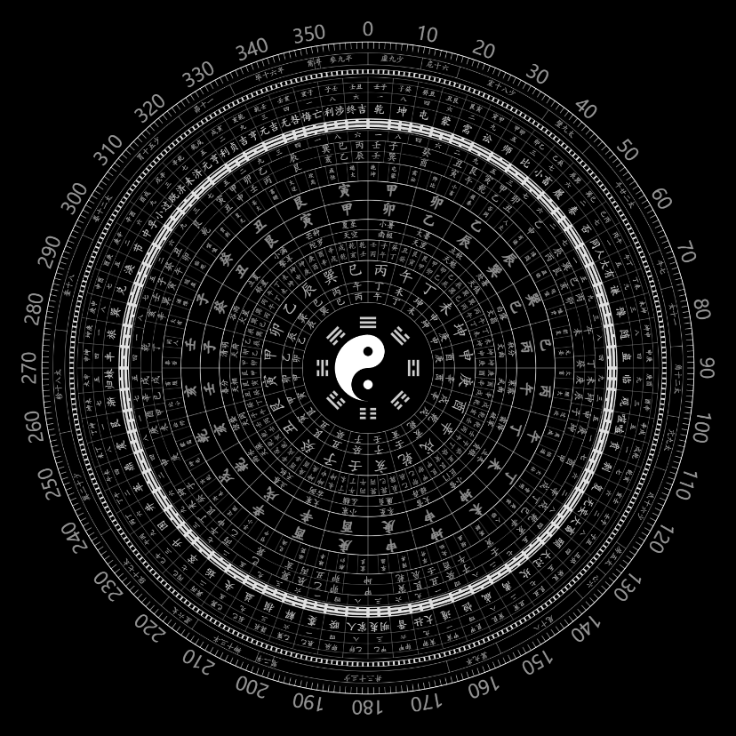

# 八卦罗盘动画

[English](README.en.md)

一个以八卦罗盘为主题的浏览器动画实验：用 HTML、CSS、JavaScript 和 SVG 绘制十层图形，探索分层自转、径向伸缩、三维翻转和波动序列。适合直接观看、检查动画状态和修改参数。



[查看三维翻转动图](docs/demo.gif) · [三维阶段截图](docs/stage-c.png)

## 直接运行

下载并解压项目，保持 `index.html`、`style.css`、`script.js` 在同一文件夹中，双击 `index.html`，用桌面浏览器打开即可。

运行不需要安装依赖、启动服务器或联网。查看代码可直接使用文本编辑器。

## 两个观看入口

页面右上角的 **Animation Debug** 面板用于选择预设和控制播放。

1. **分层旋转与伸缩（默认）**：打开页面即使用 `StageB_LayerExpansion_F_SingleFrontierGapTrigger`。可先观察这一预设，熟悉各层的运动。
2. **三维翻转与波动序列（Stage C）**：在 **Preset** 中选择 `G01_G09_3D_probe_NW15_waveSequence_v2`，点击 **Reset**；若按钮显示 **Play**，再点击它开始播放。三维效果需要 **Render** 为 `rasterized-preview`，选择该预设时程序会自动切换。

切换预设不会自动将时间归零，建议随后点击 **Reset**，从头观看。

默认 Stage B 含局部放大，部分时刻外圈会超出窗口；这是当前保留的视觉效果。动图展示 Stage C 的 7.50–15.42 秒片段，按时间轴采样制作，不代表浏览器实际帧率。

| 控件 | 用途 |
| --- | --- |
| Preset | 切换动画预设；列表中也保留了开发过程中的实验预设 |
| Render | 切换绘制方式；三维预设需要 `rasterized-preview` |
| Pause / Play | 暂停或继续播放 |
| Reset | 时间归零，保留当前的播放或暂停状态 |
| Time | 拖动查看指定时刻；拖动后自动暂停 |
| Speed | 调整各层自转倍率，不是整段动画的时间倍率；伸缩与三维序列的时间安排不会随之等比例加速 |

## 文件结构

```text
index.html          页面入口
style.css           页面与图形样式
script.js           SVG 绘制、动画预设和控制面板
docs/preview.png    演示截图
docs/VALIDATION.md  本次运行检查的范围与结果
docs/SOURCES.md     参考来源、开发方式与授权范围说明
LICENSE            MIT 许可证
```

## 使用范围

这是实验性视觉演示，不是用于测量、方位判读或传统术数实践的正式罗盘工具。部分预设用于开发调试，并非每种组合都经过完整验证；具体检查范围见[验证记录](docs/VALIDATION.md)。

文字使用系统字体，不同电脑上的字形和间距可能不同。移动端尚未验证。

## 开发与许可

项目由 [wuhanlin273-hash](https://github.com/wuhanlin273-hash) 通过 Codex 辅助迭代开发（AI-assisted implementation）。

本发布包中的代码采用 [MIT 许可证](LICENSE)。视觉参考及第三方素材的说明见[来源记录](docs/SOURCES.md)。
